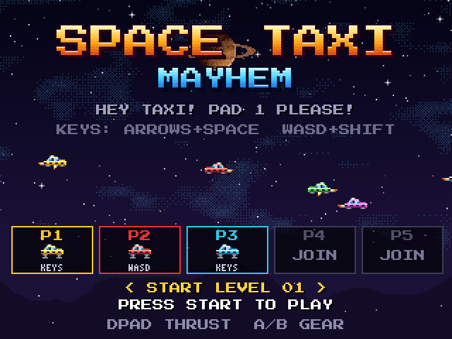
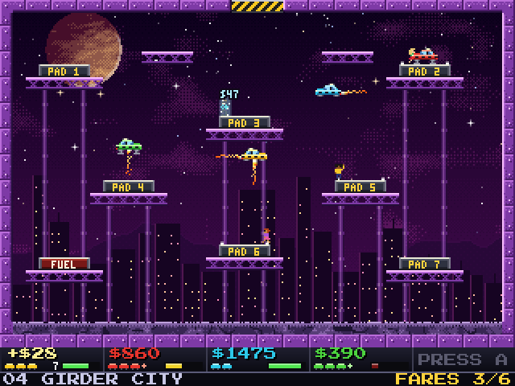

Space Taxi Mayhem
=================

A multiplayer Space Taxi game with 1-5 local players, inspired by the Amiga PD classic Space Taxi 3.

Pick up passengers, land gently on the pad they call out, and don't crash into walls, hazards, other taxis or the passengers themselves. There are 20 levels with switches, moving platforms, lasers, wind and teleporters. Fly with the D-pad and remember that you can't thrust sideways while the landing gear (A/B) is down.




How to build
---------------

- Switch:
```
docker run -it -v "$(pwd)":/app -w /app devkitpro/devkita64
cmake -S ./spacetaxi -B build-switch -DPLATFORM=SWITCH
cmake --build build-switch -j
```

- MacOS:
```
brew install cmake sdl2 sdl2_ttf
cmake -S ./spacetaxi -B build
cmake --build build -j
```
This builds `Space Taxi Mayhem.app`. To make a self-contained app that can be copied to the Applications folder on any Mac (SDL libraries included), or a .dmg to share:
```
cmake --install build --prefix dist     # -> dist/Space Taxi Mayhem.app
cd build && cpack                        # -> SpaceTaxiMayhem-1.0.0-macOS.dmg
```
The app is ad-hoc signed but not notarized, so on another Mac open it the first time with right-click → Open (or run `xattr -dr com.apple.quarantine "/Applications/Space Taxi Mayhem.app"`).

- Windows:
Install MSYS2 MinGW, then open a msys2 ucrt shell
```
pacman -S mingw-w64-ucrt-x86_64-gcc
pacman -S mingw-w64-ucrt-x86_64-cmake
pacman -S mingw-w64-ucrt-x86_64-SDL2
pacman -S mingw-w64-ucrt-x86_64-SDL2_ttf
cmake -S ./spacetaxi -B build && cmake --build build -j
curl https://raw.githubusercontent.com/rollerozxa/msys2-bundledlls/master/bundledlls > ./bundledlls
bundledlls ./spacetaxi.exe ./
```

Credits
-------

- Font: "Press Start 2P" by CodeMan38, licensed under the SIL Open Font License (see `assets/OFL-PressStart2P.txt`).
- Passenger voices: generated with [espeak-ng](https://github.com/espeak-ng/espeak-ng) (`tools/make_voices.py`).
- Libraries: [SDL2](https://www.libsdl.org) and SDL2_ttf (zlib license), FreeType.
- Inspired by Space Taxi (John F. Kutcher, Muse Software, 1984) and the Amiga PD game Space Taxi 3. This is an unaffiliated fan homage.

assisted by Claude
